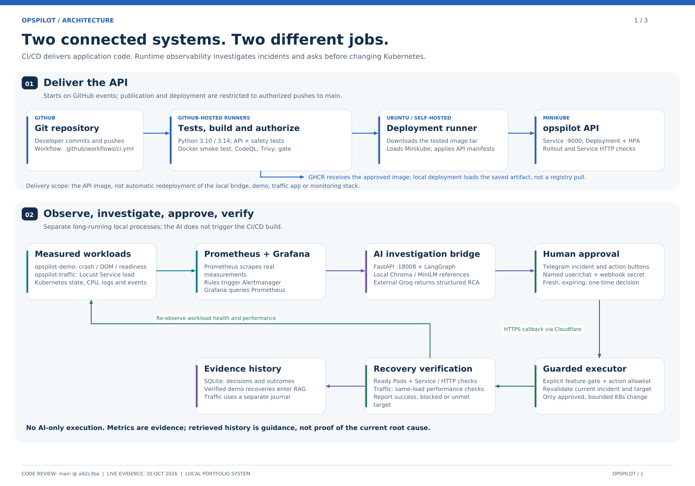
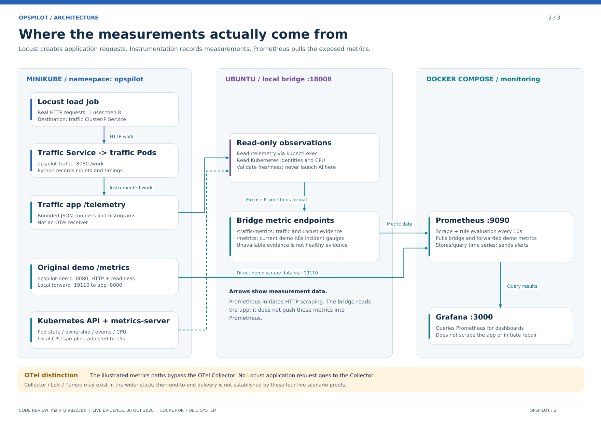
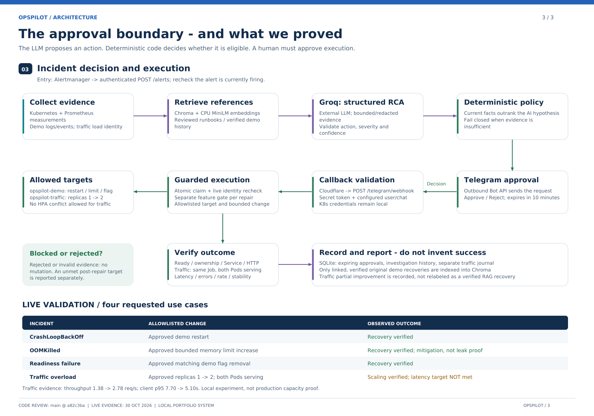

# OpsPilot — AI-Assisted DevOps Incident Response

OpsPilot is a local SRE/DevOps portfolio project that connects monitoring, AI investigation, human approval, and controlled Kubernetes recovery.

It collects operational evidence, uses Groq to suggest a diagnosis, retrieves relevant runbooks with RAG, and requests approval through Telegram before executing an allowlisted remediation.

Built with Python, FastAPI, LangGraph, Groq, Chroma, Docker, Kubernetes, Prometheus, Grafana, and GitHub Actions.

## How It Works

1. **Detect:** Prometheus evaluates application and Kubernetes metrics.
2. **Trigger:** Alertmanager sends a firing alert to the OpsPilot bridge.
3. **Investigate:** OpsPilot collects current logs, Kubernetes state, events, and metrics.
4. **Retrieve:** Semantic search finds relevant runbooks and previously verified outcomes.
5. **Analyze:** Groq produces a structured diagnosis and recommended action.
6. **Validate:** Python policy checks the recommendation against current evidence and supported actions.
7. **Approve:** An eligible remediation requires a fresh human approval through Telegram.
8. **Execute:** A deterministic Python function performs the approved action.
9. **Verify:** OpsPilot checks recovery and records the actual outcome.

The AI diagnosis is treated as a hypothesis. Recovery is recorded as verified only when the required checks pass.

## Architecture



### Metrics and Alerting



### Human Approval and Recovery



## Core Capabilities

- FastAPI services for API and integration endpoints
- LangGraph workflow for evidence collection, retrieval, analysis, and reporting
- Groq integration for structured incident analysis
- Chroma vector storage for semantic runbook and verified-outcome retrieval
- Prometheus metrics and Alertmanager incident triggers
- Grafana dashboard configuration
- Telegram incident notifications and approval callbacks
- Human approval before supported Kubernetes changes
- Deterministic remediation restricted to known demo targets
- SQLite incident history and approval tracking
- Recovery checks before recording a successful outcome
- Docker images and local Minikube deployment
- GitHub Actions workflows for testing, building, and security checks

## Three Controlled Recovery Scenarios

V1 focuses on three incidents in the local `opspilot-demo` workload.

| Incident | Approved action | Recovery checks |
| --- | --- | --- |
| Application crash / CrashLoopBackOff | Restart the allowlisted demo Deployment after confirming eligible crash evidence | Kubernetes rollout and readiness checks |
| OOMKilled / memory-limit incident | Increase the controlled demo memory limit from 256 MiB to 512 MiB | New Ready Pod, restart checks, and sustained Service HTTP success |
| Readiness failure | Clear the known demo readiness flag | Same Pod identity, ready Service endpoints, and Service HTTP success |

These actions are specific to the controlled demonstration. Increasing a memory limit is a mitigation; it does not establish that an application memory leak has been fixed.

Other failures can require manual investigation rather than automatic remediation.

## Human Approval and Execution Controls

OpsPilot separates AI recommendations from execution.

- Remediation switches are disabled by default.
- Only predefined actions and demo targets are eligible.
- Recommendations must satisfy evidence and confidence checks.
- Unsupported or invalid recommendations require manual review.
- Approvals expire and cannot be reused.
- Execution rechecks the incident and target identity.
- Rejected, expired, stale, or already-used approvals cannot authorize a new action.
- The LLM does not receive arbitrary shell or Kubernetes execution access.

## RAG and Incident History

OpsPilot uses two forms of context:

| Context | Purpose |
| --- | --- |
| Semantic retrieval | Find relevant runbooks and previously verified recovery outcomes |
| Recent incident history | Provide chronological context from actual investigations |

Runbooks live in `ai_service/knowledge/runbooks/`.

By default, Chroma data is stored under `data/chroma/`, and investigation history is stored in `data/opspilot_history.sqlite3`.

Only eligible, human-approved, successfully executed, and verified recovery outcomes are indexed as verified incident knowledge. Generated diagnoses remain hypotheses.

## Repository Guide

| Path | Contents |
| --- | --- |
| `ai_service/` | AI workflow, evidence collection, retrieval, policy, and remediation modules |
| `api_service/` | API, approval, and notification components |
| `opspilot_integration/` | Local bridge, monitoring integration, scenario tools, and verification |
| `ai_service/knowledge/runbooks/` | Operational reference material |
| `k8s/` | Kubernetes manifests |
| `tests/` | Workflow, approval, incident, and recovery tests |
| `.github/workflows/` | CI and security workflows |
| `docs/` | Setup guides, architecture, and demo documentation |

## Getting Started

The local environment uses WSL Ubuntu, Docker Desktop, and the Minikube profile `opspilot`.

Follow the setup guides before launching the bridge or running a controlled incident:

- [Kubernetes and CI/CD setup](docs/cicd-setup.md)
- [AI investigation and RAG setup](docs/ai-flow-setup.md)
- [V1 demo and verification guide](docs/v1-finish.md)
- [Readiness scenario](docs/readiness-demo.md)
- [Resource incident guide](docs/live-resource-incidents.md)

After configuring the documented dependencies and services, start the bridge from the repository root:

```bash
./venv/bin/python -m opspilot_integration.run_ai_bridge
```

This starts the bridge with remediation disabled.

Inspect recorded investigations:

```bash
./venv/bin/python -m opspilot_integration.ai_status
```

Inspect one investigation using its actual ID:

```bash
./venv/bin/python -m opspilot_integration.ai_status --incident INVESTIGATION_ID
```

Use the V1 guide for explicit remediation switches, fault injection, and recovery verification.

## Observability

Prometheus collects application metrics and Kubernetes incident gauges. Alertmanager delivers firing events to the bridge, and Grafana provides dashboard views.

The investigation workflow also collects bounded log and event snapshots. These snapshots support incident analysis and are not a complete centralized logging platform.

OpenTelemetry logging configuration is present in the API service. Export requires a reachable, correctly configured collector.

## CI/CD and Security

The repository includes GitHub Actions workflows for:

- Python tests
- Docker builds and container startup checks
- Trivy vulnerability scanning
- CodeQL analysis
- Publication and conditional local Minikube deployment

Local deployment requires the configured self-hosted runner and a running cluster. Publication and deployment depend on the workflow gates passing.

Workflow configuration alone does not demonstrate a successful deployment. Check the actual Actions results and scan reports.

## Validation and Scope

OpsPilot is a local portfolio project with controlled recovery scenarios.

Offline tests exercise workflow and policy behavior using mocked external systems. They do not establish live Groq response quality, Telegram delivery, or Kubernetes recovery.

Live validation requires observing the real alert, investigation, approval, execution, and recovery outcome. A successful Git push or source installation does not prove that sequence completed.

Credentials, environment files, local databases, and vector indexes should remain outside version control.

## Author

**Sumana Purushothama**

Building practical cloud, DevOps, observability, and AI-assisted incident response skills.

[GitHub](https://github.com/Sumana1104)


## 👤 Author

Sumana — DevOps Engineer  
Buford, GA  
Building AI-powered monitoring systems and cloud-native microservices.
