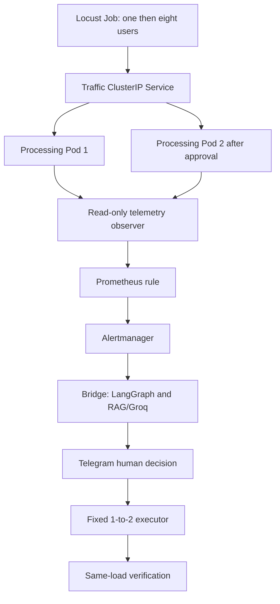

# OpsPilot: Locust-driven capacity investigation and approved scaling

## What this adds, and what it does not claim

Your crash, OOM and readiness recovery proofs remain intact. This extension is
separate from those three tests. It creates **opspilot/opspilot-traffic**, not a
replacement for opspilot-demo or your main opspilot Deployment. This separation
is necessary because the existing recovery code deliberately requires one Pod;
silently scaling that target would undermine its incident identity checks.

Traffic scenario: real Locust requests -> measured processing latency and CPU
pressure -> real Prometheus rule -> Alertmanager -> LangGraph with existing
local RAG/Groq -> policy -> fresh authenticated Telegram decision -> fixed
Deployment 1-to-2 patch -> continued-load measurements -> result.

No `/slow`, `/error`, crash.flag, readiness.flag or OOM allocator is used. Synthetic
clients send real requests to a normal `/work` endpoint doing fixed-size PBKDF2
CPU processing. The chosen algorithm is an intentionally simple capacity-test
workload, not a claim to implement a real customer-facing product. Resource
consumption and latency are measured, not fabricated. Queue-full 503s arise
only from admission control (24 outstanding jobs), not a forced error route.

The Prometheus histogram measures application queue-plus-processing duration,
not every network hop. Locust's own response-time statistics separately measure
the client view. Compare both; do not present server timing as full end-to-end
latency including all client/network overhead.

Recovery also requires recent Locust client p95 <=400ms and at least 25%
improvement, client errors <1% and client throughput not below 80% of its
pre-patch value. Live client state is reported every five seconds. Stale or
missing client measurements cannot be considered success.

This is a local capacity experiment, **not proven production autoscaling**.
Adding replicas on one node does not add node resources or guarantee improvement.
Offline tests cannot prove actual Kubernetes Service routing, registry image
availability, Groq output or laptop capacity. Those remain live checks.

## Architecture and code map



* `traffic/app.py`: a fixed real computation, one worker and bounded queue;
  health stays independently responsive. No unbounded retained-memory load.
* `traffic/locustfile.py`: one user for 90 seconds, then eight users until
  20 minutes. Only `/work`; closes each connection so a single keepalive
  connection does not pin all traffic to one backend.
* `traffic/workload.yaml`: a separate Deployment/ClusterIP Service, initially
  one replica, 250m/64Mi requests, 500m/128Mi limits per processing Pod.
* `traffic/evidence.py`: allowlisted Kubernetes reads, ownership and Service
  checks, fresh metrics-server CPU samples and actual per-Pod app counters.
  Emits Prometheus metrics; never initiates AI or approvals.
* `traffic/control.py`: four-node graph (collect, retrieve, investigate, policy),
  structured model output, SQLite incident/decision journal, one-time claim,
  narrow patch and measured outcome. Existing semantic retrieval is reused,
  with the exact reviewed traffic runbook included even if an older crash
  case ranks higher. Retrieval/provider failures go to manual review.
* `traffic/run.py`: starts the existing bridge supervisor with monitoring
  enabled and the three original repair gates off. Scaling defaults off.
* `traffic/cli.py`: explicit prepare/load/status/stop-load operator commands.
* `traffic/rules.yml`: p95 >400ms, rate >1/s, CPU >65% of container CPU limit,
  fresh available evidence and confirmed eight-user Locust burst, for 30s.
* `observability/grafana/dashboards/traffic-capacity.json`: separate traffic
  dashboard, using the existing `opspilot-prom` datasource.

The observer reads Pod-local telemetry using scoped kubectl exec because the
existing local Prometheus has no in-cluster discovery identity. It aggregates
actual per-Pod series through `/traffic/metrics`, including during two-replica
operation. This is a local-lab compromise, not recommended cluster-wide scrape
architecture. Production would normally scrape/discover workload endpoints
directly with reviewed RBAC/networking. Missing/stale data is unavailable,
not fake zeros or healthy service.

## Source installation

The downloaded installer is source-only: backs up affected source under `.git`,
checks exact before/after hashes, refuses unknown edits or staged work, and
does not start services, install packages, load the cluster, approve, commit
or push. Do not use an older installer afterward.

```bash
# From your existing project: install source, with recoverable backups.
./venv/bin/python /mnt/c/Users/suman/Downloads/opspilot-traffic-update.py --apply

# Offline regression tests. No real Kubernetes/Groq/Telegram operations.
OTEL_SDK_DISABLED=true ./venv/bin/python -m unittest discover -s tests -p 'test_*.py' -q
```

## One-time preparation (no load or scaling)

1. Leave Cloudflare running. Stop only the running bridge in its own terminal
   with Ctrl+C. Never reuse an old PID blindly.
2. Start traffic monitoring in safe mode:

```bash
# Terminal 1: existing supervisor, all repairs including scaling OFF.
cd ~/devops-ai-monitoring-agent
./venv/bin/python -m opspilot_integration.traffic.run
```

3. In a free terminal prepare the isolated workload:

```bash
# Checks safe bridge and node headroom, builds/loads one small image,
# creates ONLY the new traffic Deployment/Service and waits for rollout.
./venv/bin/python -m opspilot_integration.traffic.cli prepare --confirm-traffic-only
```

If target names already exist, preparation stops rather than overwriting them.
Use inspection, not deletion, to resolve a conflict. The namespace must already
exist. Registry downloads and a working Docker/Minikube profile are needed.
The existing opspilot HPA is left alone; an HPA targeting opspilot-traffic blocks
this executor to avoid controllers fighting over replicas.

## Run the actual traffic experiment

1. Ctrl+C only Terminal1. Enable just the traffic scaling gate:

```bash
# Terminal 1; original restart/OOM/readiness gates stay OFF.
./venv/bin/python -m opspilot_integration.traffic.run --enable-scaling
```

2. In Terminal2 run the bounded Locust Job. This is the CPU/traffic-generating
   step, not the installation or preparation step:

```bash
# Checks public authenticated Telegram route, one replica, HPA and headroom.
# Creates a scoped ConfigMap and Locust Job. No fault flag or fake alert.
./venv/bin/python -m opspilot_integration.traffic.cli load --confirm-traffic-only
```

The Job image is `locustio/locust:2.32.1` and may need downloading. It has no
Kubernetes credentials, no retries, a 21-minute hard deadline, 500m/256Mi limits
and only the fixed Service URL. Image availability is a live preflight concern;
an ImagePull error is not proof the capacity experiment ran.

3. Leave clients running for baseline, ramp and the alert's one-minute sample
   window plus 30-second hold. This takes minutes, not instant Telegram output.
   Only approve a **fresh TRAFFIC** proposal for **opspilot-traffic 1 -> 2**.
4. Leave the same load running while recovery is checked. Verification can take
   up to four minutes. Do not stop the Job, alter users or manually change
   replicas during that window. A later expired/blocked approval is not permission
   to bypass checks; the extension does not offer blind action retries.

Locust uses a **closed-loop fixed-user** load: eight users, fixed workload and
think time, not a constant externally offered arrival rate. After improvement,
achieved throughput may rise. The proof is limited to this comparable user
configuration; do not call it an equal-fixed-RPS capacity benchmark.

## What must be true before and after the patch

Before approval/execution: actual firing original alert, fresh numeric telemetry,
one ready zero-restart traffic Pod owned by the expected Deployment, unchanged
image/template/resources, original ready Service endpoints, the same active
Locust Job with recent eight-user burst report and unchanged source, no HPA,
node Ready/no pressure and at least 0.6 spare CPU plus 256Mi spare memory by
fresh node metrics. These headroom thresholds are conservative lab guards,
not guarantees about every competing workload or scheduler race.

The atomic JSON patch tests Deployment UID, resourceVersion and replicas=1,
then replaces ONLY `/spec/replicas` with 2. No image, probe, memory, CPU, node or
other Deployment change. Approval is durable, expires after ten minutes and is
claimable once. A crash after claim requires investigation; it is not presented
as exactly-once distributed execution. No automatic scale-down or extra scale-up.

Recovery: same Deployment/Pod template/Service identities and same active Locust
Job/source; two ready original-Service endpoints, zero Pod restarts and both Pods
actually receiving successful work requests. After a 70-second warmup to age out
old one-minute samples, p95 must be <=400ms AND at least 25% below its pre-patch
value; errors <1%; achieved request rate at least 80% of its pre-patch value.
All must remain good for 30s. Otherwise result is `recovery_not_verified`.

We check real backends' request counters and endpoint identities; this is not
a separate synthetic HTTP health ping presented as measured latency recovery.
The code preserves the same client Job while measuring, and will not call a
completed/stopped Job "recovered". Laptop contention can prevent improvement.

## Screenshots and useful read-only commands

```bash
# View actual Job progress; no credentials printed by the workload script.
kubectl --context opspilot -n opspilot logs job/opspilot-traffic-load --tail=30

# Inspect replicas and all targets without modifying them.
kubectl --context opspilot -n opspilot get deployment opspilot-traffic

# Read current traffic evidence/metrics; may stop if load has not started.
./venv/bin/python -m opspilot_integration.traffic.cli status

# Read stored traffic outcomes and before/after measurements, even after load stops.
./venv/bin/python -m opspilot_integration.traffic.cli history
```

Open Prometheus at http://localhost:9090/alerts and the traffic dashboard in your
existing Grafana. Grafana is for visualization; it does not trigger this repair.
The supervisor starts only Prometheus and Alertmanager, not Grafana. If Grafana
is stopped, explicitly start only that service using the existing compose base,
integration overlay and traffic overlay. Keep your existing password private.

Capture: baseline low latency/one replica; firing overload with request rate and
CPU; matching fresh Telegram approval; matching result; then p95/error/rate chart
and two replicas while the same Job is active. Include a sanitized explanation
that this is synthetic traffic and a local experiment. Never screenshot `.env`,
bot tokens, authentication headers or runtime database contents.

## Stop and safe handoff

Return Terminal1 to `traffic.run` without `--enable-scaling`, then:

```bash
# Explicitly stops ONLY labelled test-load Job/ConfigMap (also allowed in
# an emergency while scaling is on; stopping invalidates ongoing proof).
./venv/bin/python -m opspilot_integration.traffic.cli stop-load --confirm-traffic-only
```

This removes the named labelled Job/ConfigMap. No load history is generated by
cleanup; no Deployment or volume is deleted. Replica count stays at its last
approved value. No automatic reset to one replica is included. Original demo
proofs remain available through `scenario verify`.

Traffic decisions/outcomes are in local `data/traffic.sqlite3`, ignored by Git.
They are deliberately separate from the three-scenario journal and are NOT
automatically added to Chroma as successful memory. The upload-source list is
extended, but an upload still requires an explicit user command and safe mode;
publishing is not triggered by this experiment. Existing CI/dependency alerts
remain separate issues. This extension is not a security audit.

## If it does not alert or recover

Do not lower safety checks just to obtain a green screenshot. Check Locust Pod
status/Job logs, exporter availability, actual p95/rate/CPU, loaded rule and
Alertmanager delivery. If eight users do not overload your measured endpoint,
report that observation. If the node lacks headroom or scaling cannot meet the
verification thresholds, report insufficient capacity or no verified recovery.
Changing load/work parameters requires a reviewed source change and a new run,
not a hidden setting change between before/after screenshots.
